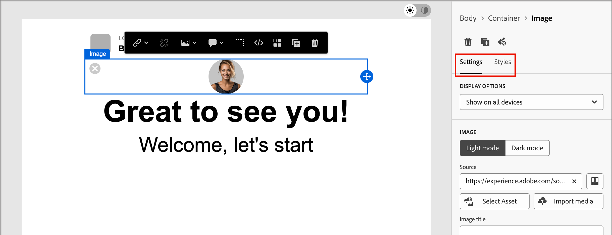

# Authoring dei contenuti - moduli

Utilizza [moduli di contenuto](../user/content/content-modules.md) per creare la progettazione dalle sezioni preparate, come intestazioni, banner, schede e piè di pagina. Ogni modulo include struttura, stile e contenuto predefinito personalizzabile.

1. Nello spazio di progettazione visiva, selezionare la scheda **[!UICONTROL Moduli]** se non è visibile.

   {width="500" zoomable="yes"}

1. Sfoglia le categorie oppure utilizza il campo di ricerca per trovare un modulo per nome.

   Espandere una categoria per esaminare le relative varianti di layout.

1. Trascina una variante del modulo nell’area di lavoro.

   {width="650" zoomable="yes"}

1. Seleziona gli elementi nel modulo per sostituire il testo, le immagini e i collegamenti predefiniti con il tuo contenuto.

1. Utilizza le schede **[!UICONTROL Impostazioni]** e **[!UICONTROL Stili]** per personalizzare il componente selezionato.

   {width="650" zoomable="yes"}

   Per aggiungere altro contenuto al modulo, seleziona la scheda **[!UICONTROL Componenti]** e trascina un componente contenuto nel modulo.