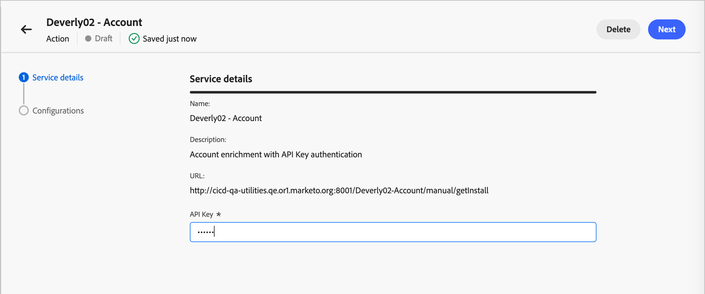
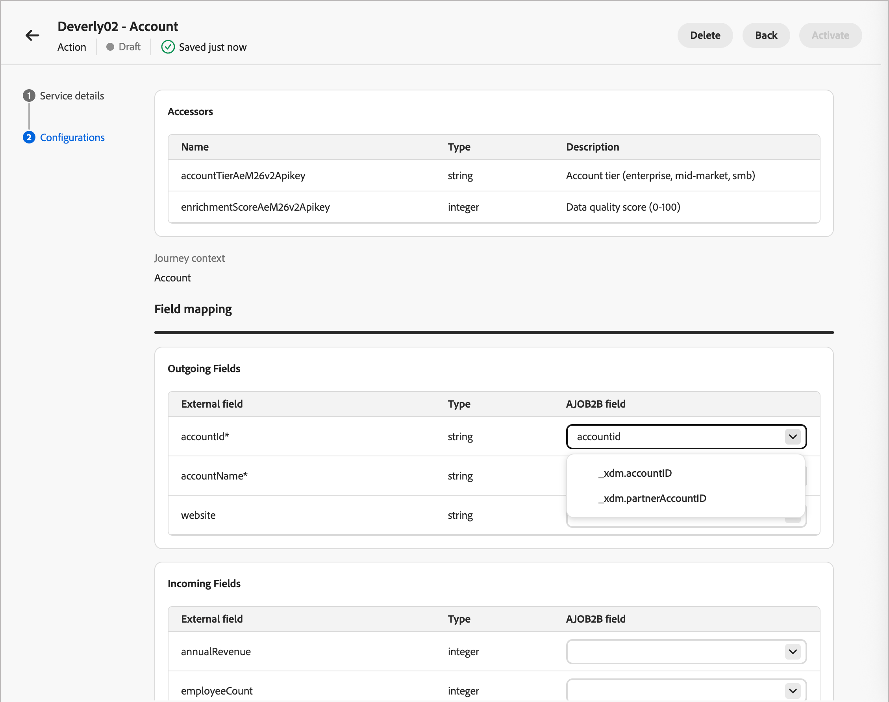

# Configurazione azioni esterne

Le azioni esterne consentono ai percorsi di account e persone in [!DNL Journey Optimizer B2B Edition] di connettersi con i sistemi esterni direttamente dall&#39;area di lavoro del percorso. Quando un pubblico raggiunge un nodo di azione esterna, il sistema effettua una chiamata in uscita asincrona a un servizio esterno configurato, trasmettendo i dati degli attributi del pubblico. Il servizio esterno elabora i dati e risponde utilizzando un callback, restituendo dati sul pubblico e metadati che possono essere utilizzati per guidare l’esecuzione del percorso.

Questa funzione supporta due tipi di nodo di percorso:

* **Azione esterna** - Chiama un servizio esterno e continua lungo un singolo percorso in uscita. Ideale per integrazioni asincrone, ad esempio per aggiornare un record CRM o attivare una notifica a valle.
* **Percorsi di suddivisione esterni** - Chiama un servizio esterno e valuta la risposta per instradare gli account o le persone lungo uno dei diversi percorsi definiti.

## Panoramica sull’implementazione

La configurazione delle azioni esterne richiede il coordinamento in tre ruoli in sequenza:

| | Ruolo | Attività |
| ---- | ---- | ---- |
| 1 | Sviluppatore | [Implementare e pubblicare il servizio esterno](#implement-service) |
| 2 | Amministratore | [Configura l&#39;azione in Journey Optimizer B2B Edition](#configure-action) e [monitora stato azione esterna](#monitor-external-action-health) |
| 3 | Addetto marketing | [Aggiungere un nodo esterno a un percorso](#add-journey-node) |

## Implementare il servizio esterno {#implement-service}

Lo sviluppatore deve creare e pubblicare un servizio Web pubblico conforme all&#39;[Interfaccia provider di servizi per azioni esterne Adobe Journey Optimizer B2B Edition](https://developer.adobe.com/journey-optimizer-b2b-apis/).

>[!NOTE]
>
>La funzione di callback richiede un token Bearer. Per recuperarlo, imposta [le credenziali da server a server OAuth in Adobe Developer Console](https://developer.adobe.com/developer-console/docs/guides/authentication/ServerToServerAuthentication/implementation) per la tua organizzazione IMS.

Dopo che il servizio è attivo, fornisci l’URL della specifica OpenAPI e le credenziali di autenticazione all’amministratore del prodotto responsabile della configurazione dell’azione.

## Configurare l’azione {#configure-action}

Un’azione deve essere configurata e attivata prima che gli addetti al marketing possano utilizzarla in un percorso. Le azioni vengono create nello stato _Bozza_ e le modifiche vengono salvate automaticamente. Rimane come bozza finché non la attivate.

>[!PREREQUISITES]
>
>Prima di aggiungere la configurazione, richiedi l’URL per la specifica OpenAPI e le credenziali di autenticazione allo sviluppatore.
>
>Per definire e attivare un&#39;azione esterna, è necessario disporre dell&#39;autorizzazione _[!UICONTROL Gestisci configurazioni amministratore B2B]_ [prodotto](./user-management.md#b2b-product-permissions).

1. Vai a **[!UICONTROL Amministrazione]** > **[!UICONTROL Configurazioni]**.

1. Fai clic su **[!UICONTROL Azioni esterne]** nel pannello intermedio.

1. Fai clic sulla scheda **[!UICONTROL Sfoglia]**.

   {width="800" zoomable="yes"}

1. Fai clic su **[!UICONTROL Crea azione]** in alto a destra.

1. Immetti l&#39;URL della specifica OpenAPI per il servizio esterno e fai clic su **[!UICONTROL Crea]**.

   {width="500"}

   Affinché questo passaggio abbia esito positivo, il servizio esterno deve essere attivo e raggiungibile. In caso di errore di convalida, nella finestra di dialogo viene visualizzato un messaggio che descrive l’errore e un suggerimento per risolverlo. Per ulteriori informazioni, vedere [_Risoluzione dei problemi_](#troubleshooting).

1. Quando l&#39;URL viene risolto correttamente, esaminare i **[!UICONTROL Dettagli servizio]**.

   I dettagli del servizio vengono letti direttamente dalla specifica OpenAPI al momento della creazione dell’azione. Non è possibile modificare queste proprietà nella configurazione dopo la creazione.

   | Proprietà | Descrizione | Proprietà delle specifiche OpenAPI |
   | -------- | ----------- | --------------------- |
   | [!UICONTROL Nome] | Nome dell’azione | `info.title` |
   | [!UICONTROL Descrizione] | Descrizione dell’azione | `info.description` |
   | [!UICONTROL URL] | URL della specifica OpenAPI che definisce il servizio esterno | `servers.url` |

1. Immettere le credenziali di **[!UICONTROL Autenticazione]** per il servizio esterno (`components.securitySchemes`).

   >[!NOTE]
   >
   >I campi delle credenziali visualizzati dipendono dal meccanismo di autenticazione definito nel servizio esterno. I tipi supportati sono API Key, OAuth2 e HTTP Basic Authentication.

   {width="600" zoomable="yes"}

   È possibile modificare le credenziali in base alle esigenze quando l&#39;azione configurata è nello stato _Bozza_ o _Attivo_.

1. Fai clic su **[!UICONTROL Avanti]**.

1. Per definire il modo in cui l&#39;azione scambia i dati con il servizio esterno, impostare le proprietà **[!UICONTROL Configurations]**.

   >[!NOTE]
   >
   >Le proprietà contrassegnate come _Statiche_ non sono aggiornabili al momento della configurazione e si basano sulla definizione del servizio.

   * **[!UICONTROL Tipo di azione]** (_Statico_) - Tipo di nodo di percorso supportato:

     * [!UICONTROL Azione esterna] (`enableSplitPath` = false)
     * [!UICONTROL Percorso suddivisione azione esterna] (`enableSplitPath` = true)

     Non puoi modificare il tipo di azione dopo aver creato la configurazione dell’azione.

   * **[!UICONTROL Funzioni di accesso]** (_Static_) - (Solo percorso suddiviso azione esterna) Le variabili restituite dal servizio esterno sono disponibili come condizioni di percorso in un nodo di percorso suddiviso esterno. (`invocationPayloadDef.accessorsMetadata`)

   * **[!UICONTROL Contesto Percorso]** (_Statico_) - Ambito dei dati del pubblico inviati nella richiesta (`supportedEntityType`):

     * [!UICONTROL Account] - Invia solo gli account

     * [!UICONTROL Persone] - Invia solo persone

     * [!UICONTROL Persone nell&#39;account] - Invia account e persone correlate all&#39;account

   * **[!UICONTROL Campi in uscita]** - Mappa ogni campo della tabella su un [campo XDM](../admin/xdm-field-management.md). Questi campi vengono inviati nel corpo della richiesta al servizio esterno. Proprietà definizione servizio: `invocationPayloadDef.accountFields`, `invocationPayloadDef.fields`.

     {width="600" zoomable="yes"}

   * **[!UICONTROL Campi in ingresso]** - Mappa ogni campo della tabella su un [campo XDM aggiornabile](../admin/xdm-field-management.md#updatable-fields). Questi campi vengono compilati dalla risposta del servizio esterno. Proprietà definizione servizio: `callbackPayloadDef.accountFields`, `callbackPayloadDef.fields`. Aggiornabile dopo la creazione.

   * **[!UICONTROL Parametri intestazione]** - Immettere un valore per ogni riga da passare come intestazione HTTP nella richiesta. Proprietà definizione servizio: `invocationPayloadDef.headers`.

   * **[!UICONTROL Timeout]** - Immettere il numero di minuti di attesa per il richiamo del callback da parte del servizio esterno prima che la richiesta venga considerata non riuscita. Proprietà definizione servizio: `timeout`.

   * **[!UICONTROL Attributi globali]** - Immettere un valore per ogni riga da includere come campo statico nel corpo della richiesta. Proprietà definizione servizio: `invocationPayloadDef.globalAttributes`.

     {width="600" zoomable="yes"}

1. Fai clic sulla _freccia Indietro_ per tornare all&#39;elenco e mantenere l&#39;azione nello stato _Bozza_.

   In alternativa, fare clic su **[!UICONTROL Attiva]** per modificare la configurazione dell&#39;azione allo stato _Attivo_. L’azione esterna configurata deve essere attiva per renderla disponibile per l’utilizzo in percorsi.

### Risoluzione dei problemi {#troubleshooting}

Quando si immette l&#39;URL della specifica OpenAPI per il servizio esterno e si fa clic su **[!UICONTROL Crea]**, il sistema esegue la convalida del servizio. Quando viene rilevato un errore, nella finestra di dialogo viene visualizzato un messaggio che descrive l’errore.

{width="600" zoomable="yes"}

>[!NOTE]
>
>Molti dei seguenti errori richiedono la collaborazione con lo sviluppatore che ha creato e pubblicato il servizio web pubblico per risolverli.

#### Dettagli errore di convalida

| Errore visualizzato | Perché è successo | Cosa fare |
|---|---|---|
| `This URL is already used by another external action` | Questo URL della specifica è già registrato per un&#39;altra azione nell&#39;organizzazione. | Utilizza un URL di specifica diverso o elimina l’azione esistente che lo utilizza già. |
| `An action with this name already exists` | `info.title` nella specifica corrisponde a un&#39;azione già esistente | Modificare il titolo nel campo `info.title` della specifica in modo che sia univoco. |
| `Duplicate operation ID found in the specification` | Due o più operazioni nella specifica condividono lo stesso `operationId`. | Assegna a ogni operazione un `operationId` univoco. |
| `Field in the specification exceeds the maximum allowed length` | Un campo di testo nella specifica (ad esempio un titolo o una descrizione) è troppo lungo. | Abbreviare il campo contrassegnato. |
| `The entity type value is invalid` | Valore non riconosciuto per un&#39;estensione `x-` specifica per Adobe per il tipo di entità | Correggi il tipo di entità in un valore supportato. Per informazioni sulle opzioni valide, consulta la [documentazione per sviluppatori](https://developer.adobe.com/journey-optimizer-b2b-apis/). |
| `The provided document is not a valid OpenAPI specification` | La specifica non può essere analizzata strutturalmente. | Convalida le specifiche in base allo schema OpenAPI 3.0 e correggi eventuali problemi. |
| `Required OpenAPI field is missing` | Un campo OpenAPI standard richiesto è assente (ad esempio `info` o `paths`). | Aggiungi il campo mancante. |
| `Required endpoint is missing from the specification` | Un endpoint richiesto da Adobe Journey Optimizer B2B Edition non è definito nelle specifiche. | Aggiungi l’endpoint richiesto. Consulta la [documentazione per gli sviluppatori](https://developer.adobe.com/journey-optimizer-b2b-apis/) per cui sono necessari endpoint. |
| `Required extension field is missing` | Manca un campo di estensione Adobe `x-` richiesto nelle specifiche. | Aggiungi il campo di estensione mancante come descritto nella documentazione. |
| `Security schemes are missing from the specification` | Nessun `securitySchemes` definito nella specifica in `components`. | Definire almeno uno schema di protezione. |
| `Multiple authentication types are not supported` | La specifica definisce più schemi di autenticazione. | Aggiorna la specifica per utilizzare un singolo tipo di autenticazione. |
| `The authentication type is not supported` | Il tipo di schema di protezione utilizzato (ad esempio `oauth2` o `openIdConnect`) non è supportato. | Passa a un tipo di autenticazione supportato. Per informazioni sulle opzioni supportate, consulta la documentazione per gli sviluppatori. |
| `The OpenAPI version is not supported` | Mancata corrispondenza delle versioni a livello di specifica | Aggiorna la specifica per utilizzare OpenAPI 3.0.x. |
| `An unexpected error occurred` | È stato riscontrato un problema non classificato nella specifica. | Controllare la presenza di eventuali anomalie nelle specifiche e riprovare. Se l’errore persiste, contatta il supporto tecnico. |

<!--
## Errors you'll see if something goes wrong with the request itself

This error appears below the URL field (not in the alert banner) and means there was a network problem or an unexpected server response — not a problem with your URL or spec.

| What you'll see | Why it happened | What to do |
|---|---|---|
| `Failed to create external action. Please try again.` | A network error occurred or the server returned an unexpected response | Check your connection and try again. If it keeps happening, contact support |
-->

## Monitorare lo stato dell’azione esterna {#monitor-health}

Dopo che gli addetti al marketing hanno iniziato a utilizzare le azioni esterne nei percorsi, puoi tenere traccia delle prestazioni di ogni azione dalla scheda _Panoramica_ della pagina delle azioni esterne. Utilizzala per vedere quante richieste riceve ogni azione, quante non riesce e quali azioni presentano i tassi di errore più elevati.

Per visualizzare il dashboard:

1. Vai a **[!UICONTROL Amministrazione]** > **[!UICONTROL Configurazioni]**.

1. Fai clic su **[!UICONTROL Azioni esterne]** nel pannello intermedio.

   Per impostazione predefinita, il sistema visualizza la scheda **[!UICONTROL Panoramica]** con i dati delle azioni esterne relativi agli ultimi sette giorni.

1. Selezionare il periodo da esaminare dal menu dell&#39;intervallo di date oppure immettere una data di inizio e una data di fine nel campo data. L’intervallo predefinito è gli ultimi 30 giorni.

   {width="700" zoomable="yes"}

   Le metriche e la tabella vengono aggiornate in modo da mostrare solo l’attività del periodo selezionato.

### Metriche {#metrics}

Nella sezione _Panoramica_ sono riepilogate le prestazioni di tutte le azioni esterne per il periodo selezionato.

| Metrica | Descrizione |
| ---- | ---- |
| [!UICONTROL Azioni totali] | Numero di azioni esterne incluse nel rapporto. |
| [!UICONTROL Richieste totali] | Numero totale di richieste effettuate a servizi esterni in tutte le azioni. |
| [!UICONTROL Errori totali] | Numero totale di richieste che hanno restituito un errore. |
| [!UICONTROL Percentuale errori] | Percentuale di richieste che hanno restituito un errore. |

### Prestazioni delle azioni {#actions}

Nella tabella delle prestazioni _Azioni_ sono elencate tutte le azioni esterne e le relative attività per il periodo selezionato.

| Colonna | Descrizione |
| ---- | ---- |
| [!UICONTROL Nome] | Nome dell’azione esterna. |
| [!UICONTROL Numero richieste] | Numero di richieste effettuate al servizio esterno dell&#39;azione. |
| [!UICONTROL Conteggio errori] | Numero di richieste che hanno restituito un errore. |
| [!UICONTROL Percentuale errori] | Percentuale di richieste che hanno restituito un errore. |

Utilizza la tabella per confrontare le azioni e trovare quelle che richiedono attenzione. Ad esempio, un’azione con un tasso di errore elevato indica un problema con il servizio esterno, le relative credenziali di autenticazione o la relativa configurazione. Collabora con lo sviluppatore che ha implementato il servizio per indagare sulla causa.

## Aggiungere un nodo esterno a un percorso {#add-journey-node}

Dopo l&#39;attivazione di un&#39;azione, gli addetti al marketing possono aggiungere un nodo _[!UICONTROL Azione esterna]_ o _[!UICONTROL Percorso suddiviso esterno]_ a qualsiasi percorso di account o persone. Per informazioni su come aggiungere e utilizzare questi nodi nell&#39;area di lavoro del percorso, vedere [Nodi esterni](../journeys/external-nodes.md).

{width="600" zoomable="yes"}
