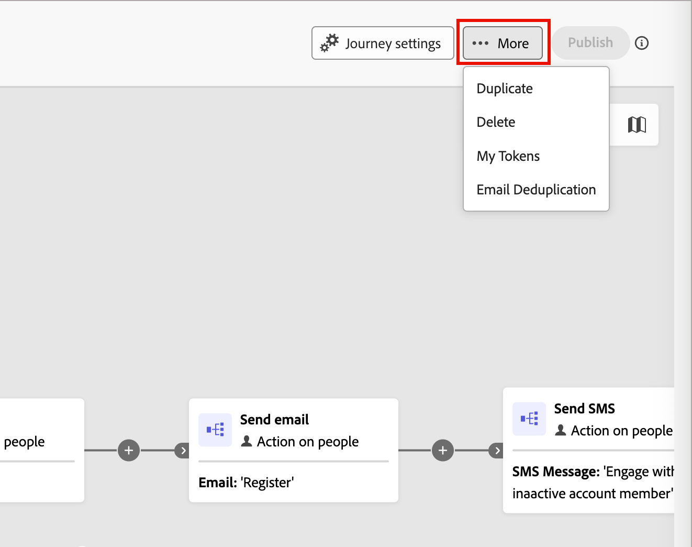
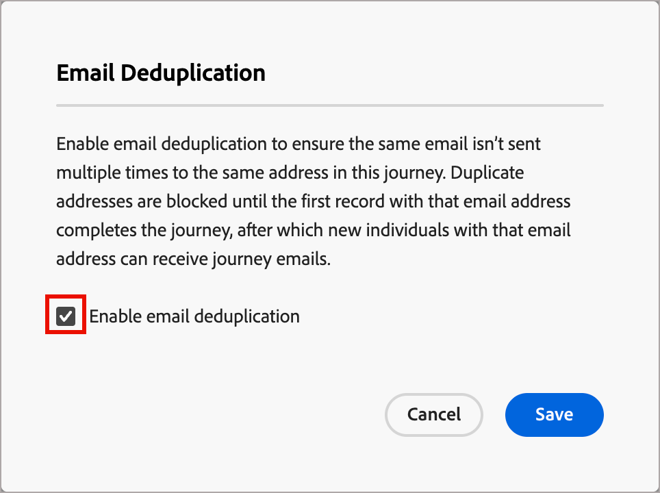

# Deduplicazione e-mail

Per evitare che la stessa e-mail venga inviata più volte allo stesso indirizzo e-mail all’interno di un percorso, utilizza la deduplicazione e-mail nei percorsi di account. Quando abiliti questa funzione, gli indirizzi e-mail duplicati vengono bloccati fino a quando il primo record con tale indirizzo e-mail non completa il percorso. Al termine di un percorso di account, una persona può qualificarsi per ricevere nuovamente le e-mail come parte di un nuovo account che accede al percorso.

## Quando utilizzare la deduplicazione e-mail

Esistono alcuni scenari chiave da considerare per abilitare la deduplicazione delle e-mail:

* **L&#39;indirizzo e-mail non è utilizzato come identità in Real-Time CDP**. Lo stesso indirizzo e-mail potrebbe essere visualizzato in più profili di persona. Se tali profili duplicati sono idonei per lo stesso percorso e desideri impedire l’invio dell’e-mail più di una volta, abilita questa funzione.

* **Singola persona associata a più account** - Se il modello dati di [!DNL Real-Time CDP] associa una singola persona a più account, abilitare questa funzione per evitare di inviare la stessa e-mail due volte quando più profili con lo stesso indirizzo e-mail sono idonei per lo stesso percorso.

>[!NOTE]
>
>La deduplicazione delle e-mail si applica a livello di percorso. Se una persona con lo stesso indirizzo e-mail si qualifica per percorsi diversi, può comunque ricevere e-mail da ogni percorso.

## Abilitare la deduplicazione delle e-mail per un percorso

Per abilitare la deduplicazione delle e-mail per un percorso di account:

1. Apri un percorso di account.

1. Fai clic su **[!UICONTROL Altro]** (**...**) nell&#39;angolo superiore destro dell&#39;area di lavoro percorso.

   {width="450"}

1. Scegli **[!UICONTROL Deduplicazione e-mail]**.

1. Nella finestra di dialogo, seleziona la casella di controllo **[!UICONTROL Deduplicazione e-mail]**.

   {width="400"}

1. Fai clic su **[!UICONTROL Salva]**.

Quando la deduplicazione e-mail è abilitata, il percorso controlla ogni indirizzo e-mail prima di inviarlo. Se un record con lo stesso indirizzo e-mail è già entrato in quel nodo di percorso, la nuova voce viene bloccata fino a quando il primo record non completa il percorso.
