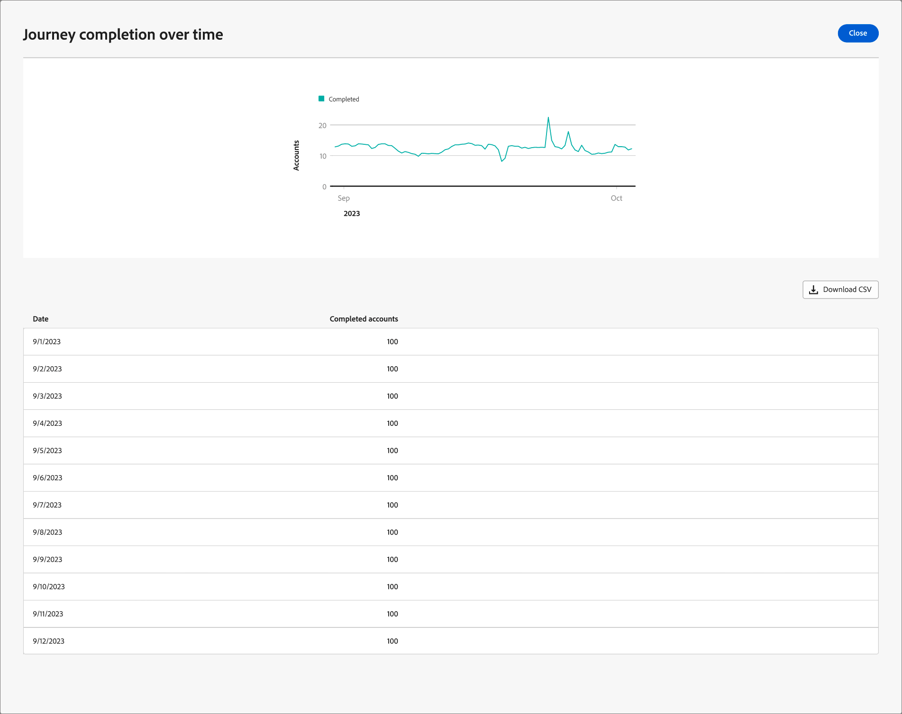

# Dettagli del percorso

In [!DNL Adobe Journey Optimizer B2B Edition], aprire un account o un percorso di persone pubblicato e selezionare la scheda **[!UICONTROL Panoramica]**. Esaminare lo stato di avanzamento, il coinvolgimento e le prestazioni del canale per il percorso selezionato.

I percorsi di account segnalano l&#39;avanzamento dei conti. I percorsi di persone segnalano l’avanzamento per le persone. I widget e le etichette delle metriche disponibili variano a seconda del tipo di percorso. Seleziona la scheda corrispondente per i dettagli del dashboard.

Per le metriche e-mail aggregate tra percorsi, utilizza il [Rapporto sulle prestazioni delle e-mail](../dashboards/email-performance-dashboard.md).

>[!BEGINTABS]

>[!TAB percorsi di account]

Il dashboard del percorso di account mostra l’avanzamento dell’account, il coinvolgimento, le prestazioni del canale e i riepiloghi generativi sull’intelligenza artificiale. Sono necessarie circa quattro ore prima che i dati inizino a popolare i grafici e le tabelle.

{width="700" zoomable="yes"}

## Completamento percorso

Questa sezione presenta due metriche di completamento:

* **[!UICONTROL Stato degli account nel percorso]**: mostra il conteggio totale degli account e un raggruppamento per stato del percorso, inclusi _Completati_, _In corso_ e _Interrotti_. Ogni segmento visualizza uno stato, una percentuale e un conteggio dei conti.
* **[!UICONTROL Account completati nel tempo]**: mostra il numero di account che hanno completato il percorso nel tempo. L&#39;asse orizzontale mostra le date e l&#39;asse verticale i conteggi dei conti.

>[!NOTE]
>
>Nei percorsi di account, il grafico **[!UICONTROL Stato degli account nel percorso]** include gli account che hanno attraversato il percorso, anche se sono stati successivamente eliminati. **[!UICONTROL Il drill-through]** esclude gli account eliminati, pertanto può visualizzare un numero di record inferiore rispetto al grafico. Questa differenza è prevista. L’eliminazione dei conti non modifica i conteggi dello stato storico del percorso.

## Coinvolgimento percorso

Questa sezione presenta due metriche di coinvolgimento:

* **[!UICONTROL Coinvolgimento per account]** - Questo grafico a cerchi segmenta gli account di un percorso in _Categorie Coinvolte_ e _Non Coinvolte_. Nella figura centrale viene visualizzato il conteggio totale. Questa visualizzazione offre una rapida comprensione del coinvolgimento complessivo dell’account.
* **[!UICONTROL Coinvolgimento da parte di persone]**: mostra il numero di persone con attività di coinvolgimento nel percorso. Questo valore conta le persone, non le attività di coinvolgimento.

## Prestazioni del percorso

Questa sezione presenta due metriche vitali:

* **[!UICONTROL Tasso di completamento Percorsi]** - Percentuale di account che hanno completato correttamente il percorso.
* **[!UICONTROL Tempo medio di completamento del percorso]**: tempo medio impiegato dai conti per completare il percorso, espresso in giorni.

## Prestazioni del canale {#email-and-sms-performance}

Il dashboard include **[!UICONTROL tabelle Prestazioni e-mail]**, **[!UICONTROL Prestazioni SMS]** e **[!UICONTROL Prestazioni WhatsApp]** per il percorso di account selezionato. Utilizza le metriche di consegna e coinvolgimento disponibili per valutare ogni punto di contatto di comunicazione.

**[!UICONTROL Prestazioni e-mail]** colonne tabella:

* _[!UICONTROL Nome risorsa]_ - Nome risorsa
* _[!UICONTROL Inviato]_ - Numero di e-mail inviate
* _[!UICONTROL Percentuale di recapito]_ - Numero di e-mail consegnate diviso per il numero inviato
* _[!UICONTROL Percentuale aperture]_ - Numero di messaggi e-mail aperti diviso per il numero di messaggi consegnati
* _[!UICONTROL Percentuale di click-through]_ - Numero di e-mail su cui è stato fatto clic diviso per il numero di messaggi consegnati

**[!UICONTROL Prestazioni SMS]** colonne di tabella:

* _[!UICONTROL Nome risorsa]_ - Nome risorsa
* _[!UICONTROL Inviato]_ - Numero di messaggi SMS inviati
* _[!UICONTROL Percentuale di recapito]_ - Numero di messaggi SMS recapitati diviso per il numero inviato
* _[!UICONTROL Percentuale di click-through]_ - Numero di messaggi SMS selezionati diviso per il numero recapitato
<!--
To generate a shareable PDF of your current view, click **[!UICONTROL Export]** at the top right of the page. 
-->

## Azioni aggiuntive

Utilizzare il menu **...** per un grafico o una tabella per accedere alle azioni disponibili.

### Drill-through

Per il grafico **[!UICONTROL Stato degli account nel percorso]**, scegliere **[!UICONTROL Analisi approfondita]** per un&#39;analisi approfondita dei singoli stati degli account.

{width="600" zoomable="yes"}
<!--
The applied global filters are carried over to the view and displayed at the top. Click the _Filter_ icon at the top left to filter the data display by journey.
-->

### Visualizza altro

Scegliere **[!UICONTROL Visualizza altro]** per accedere ai dati estesi. Il pop-up visualizzato fornisce un raggruppamento dei dati.

{width="600" zoomable="yes"}

Per scaricare i dati, seleziona **[!UICONTROL Scarica CSV]**. Per tornare alla dashboard _[!UICONTROL Panoramica]_, selezionare **[!UICONTROL Chiudi]**.

>[!TAB percorsi di persone]

Il dashboard percorso di persone mostra le prestazioni di completamento, coinvolgimento e e-mail per le persone nel percorso selezionato.

{width="700" zoomable="yes"}

## Completamento percorso {#person-journey-completion}

Utilizza i seguenti grafici per esaminare lo stato delle persone nel percorso e le tendenze di completamento:

* **[!UICONTROL Stato delle persone nel percorso]**: mostra il numero totale di persone e un raggruppamento per stato del percorso. Ogni segmento mostra uno stato, una percentuale e un conteggio di persone.
* **[!UICONTROL Persone completate nel tempo]**: mostra il numero di persone che hanno completato il percorso nel tempo. La serie **[!UICONTROL Incremental completed]** mostra i completamenti per ogni intervallo di tempo. La serie **[!UICONTROL Cumulativo completato]** mostra il totale parziale di completamenti.

>[!NOTE]
>
>Nei percorsi di persone, il grafico **[!UICONTROL Status delle persone nel percorso]** include le persone che hanno attraversato il percorso, anche se sono state successivamente eliminate. **[!UICONTROL Il drill-through]** esclude le persone eliminate, pertanto può visualizzare un numero di record inferiore rispetto al grafico. Questa differenza è prevista. L’eliminazione delle persone non modifica i conteggi dello stato storico del percorso.

Per il grafico _[!UICONTROL Status delle persone nel percorso], fare clic su thw_ More_ ( **...** ) icon e selezionare **[!UICONTROL Drill through]** per esaminare gli stati delle singole persone.

## Coinvolgimento percorso {#person-journey-engagement}

Il widget **[!UICONTROL Coinvolgimento da persone]** mostra il numero di persone con attività di coinvolgimento nel percorso. Questo valore conta le persone, non le attività di coinvolgimento.

## Prestazioni del percorso {#person-journey-performance}

Utilizza le metriche seguenti per esaminare le prestazioni di completamento:

* **[!UICONTROL Tasso di completamento Percorsi]**: percentuale di persone che hanno completato il percorso.
* **[!UICONTROL Tempo medio di completamento del percorso]**: tempo medio impiegato dagli utenti per completare il percorso, espresso in giorni.

## Prestazioni e-mail {#person-journey-email-performance}

La tabella delle prestazioni **[!UICONTROL E-mail]** mostra i conteggi per ogni risorsa e-mail nel percorso di persone selezionato, anziché le tariffe:

* **[!UICONTROL Nome risorsa]**: nome della risorsa e-mail
* **[!UICONTROL Inviato]**: numero di e-mail inviate
* **[!UICONTROL Recapitato]**: numero di e-mail consegnate
* **[!UICONTROL Aperto]**: numero di e-mail aperte
* **[!UICONTROL Clic]**: numero di e-mail su cui è stato fatto clic

>[!ENDTABS]
