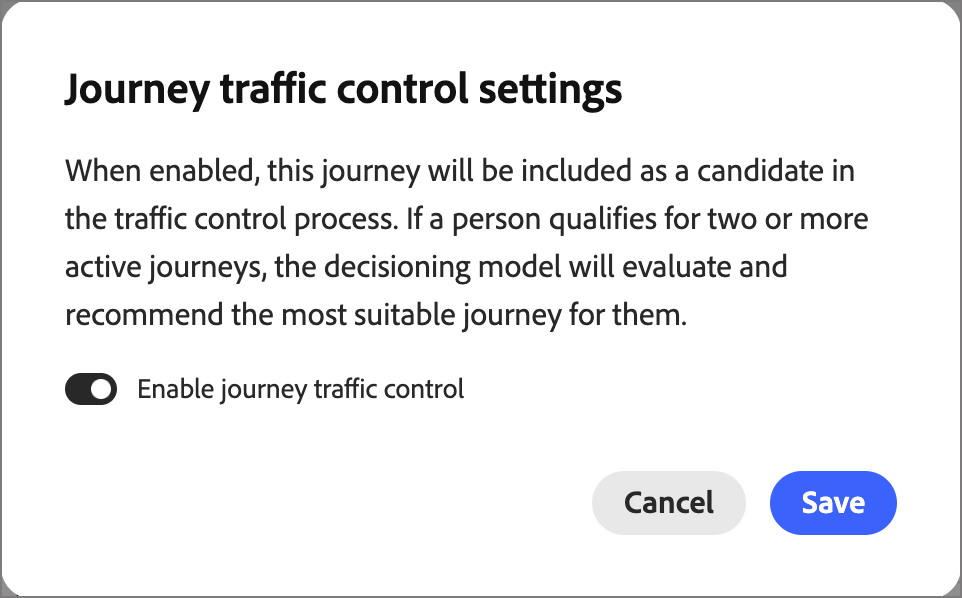

# Controllo traffico percorso

In [!DNL Adobe Journey Optimizer B2B Edition], i tipi di pubblico si sovrappongono spesso. Un direttore marketing di un&#39;azienda di servizi finanziari può qualificarsi per il percorso di settore, il percorso di interesse del prodotto e il percorso di account aziendale nello stesso giorno. Senza coordinamento, la persona è iscritta a tutti e tre e riceve messaggi concorrenti o ridondanti. Utilizza il controllo del traffico di _Percorso_ per iscrivere ogni persona al percorso di persone che meglio si adatta a loro quando sono idonei per più di un percorso alla volta.

Il controllo del traffico di percorso esamina ogni persona che si qualifica per più di un percorso partecipante. Confronta le informazioni disponibili sulla persona con ogni scopo del percorso e la iscrive nella migliore corrispondenza possibile. Una persona che si qualifica per un solo percorso è iscritta a quel percorso. Non viene iscritta una persona che non ha i requisiti per nessuna.

## Vantaggi del controllo del traffico percorso {#benefits}

Il controllo del traffico di percorso sostituisce la gestione manuale della sovrapposizione con una decisione registrata basata sull’adattamento per ogni persona.

| Senza controllo del traffico percorso | Con controllo traffico percorso |
|---|---|
| Una persona che corrisponde a più tipi di pubblico viene iscritta in diversi percorsi e riceve messaggi sovrapposti. | Ogni persona è iscritta al massimo in un percorso partecipante per ogni valutazione. |
| I team gestiscono la sovrapposizione manualmente con i segmenti di esclusione e le regole del pubblico. Queste regole diventano più difficili da mantenere con ogni nuovo percorso. | Il sistema sceglie in base all&#39;adattamento. Non si genera o si mantiene la logica di esclusione. |
| È difficile spiegare il motivo per cui una persona ha ricevuto un determinato percorso. | Ogni decisione è registrata e visualizzabile, incluso il punteggio per ogni percorso concorrente. |
| L’eccesso di messaggi e i messaggi misti riducono il coinvolgimento. | Ogni persona ha un’esperienza rilevante e coerente. |

## Esempi di utilizzo {#examples}

Utilizza il controllo del traffico del percorso quando i percorsi sono rivolti a tipi di pubblico sovrapposti. Ad esempio:

* **Programmi di sviluppo del settore**: si eseguono percorsi separati per i settori Financial Services, Healthcare e Manufacturing. Un contatto non ha alcun valore di settore, ma il suo profilo è collegato a un conto bancario. Il controllo del traffico di percorso associa il contatto al percorso di servizi finanziari invece di registrarli in tutti e tre.
* **Campagne di interesse per il prodotto**: esegui un percorso per ogni linea di prodotti. Un cliente potenziale con segnali di interesse recenti in due prodotti è iscritto al percorso per il prodotto con il maggiore interesse.
* **Messaggistica basata sui ruoli**: esegui un percorso per i valutatori tecnici e un altro per gli sponsor esecutivi. La qualifica e la funzione di una persona decidono a quale percorso partecipare.
* **Programmi Enterprise e SMB**: vengono eseguiti percorsi diversi in base alle dimensioni dell&#39;azienda. Le informazioni relative al segmento cliente e all&#39;account di un contatto determinano il percorso a cui il contatto si unisce.
* **Avvii di un nuovo percorso**: pubblichi un nuovo percorso in un pubblico già coperto da altri percorsi. Il controllo del traffico del percorso valuta la sovrapposizione, pertanto non riprogettare le regole del pubblico esistenti.

## Selezione per adattamento {#dimensions}

Quando una persona è idonea per più di un percorso, il controllo del traffico del percorso confronta il profilo della persona con il nome e la descrizione di ciascun percorso candidato. Il confronto riguarda quattro dimensioni.

| Dimensione | Cosa viene confrontato |
|---|---|
| Settore | L&#39;industria della persona. Se manca il settore, il settore dell’account collegato. |
| Adattamento funzionale | Il ruolo e la funzione lavorativa della persona. |
| Dimensione società | Il segmento cliente della persona, il tipo di conto e il contesto di spesa. |
| Intento | Il prodotto per il quale la persona ha mostrato il maggiore interesse recente. |

Considera i punti seguenti:

* **I nomi e le descrizioni dei Percorsi contano.** Dicono al sistema a cosa serve ogni percorso. Descrizioni specifiche e accurate producono corrispondenze migliori.
* **I dati mancanti sono stati ignorati, non è possibile supporli.** Se una persona non ha valore per una dimensione, il controllo del traffico di percorso non considera tale dimensione per quella persona. Prende la decisione sulle dimensioni che hanno dati.

Il record di decisione per ogni persona nelle visualizzazioni dei rapporti mostra il punteggio per ogni percorso concorrente e le dimensioni utilizzate. Una dimensione senza dati è contrassegnata come esclusa.

### Confronti {#comparisons}

Per ogni dimensione, il controllo del traffico del percorso confronta il testo rilevante della persona, ad esempio la qualifica, con la descrizione di ciascun percorso. Vengono utilizzati due metodi:

* **Simile significato**: il testo ha un significato simile alla descrizione?
* **Corrispondenza parole chiave**: il testo utilizza gli stessi termini della descrizione?

Il risultato più forte dei due metodi diventa il punteggio del percorso per quella dimensione.

Ogni dimensione propone quindi il suo percorso di punteggio migliore, ma solo se il punteggio cancella una soglia minima di qualità. I percorsi senza una proposta qualificata vengono eliminati. I pesi configurati classificano i percorsi rimanenti in base ai loro punteggi ponderati combinati. Viene selezionato il percorso con il punteggio più alto. Il vincitore non è necessariamente il percorso con il maggior numero di proposte. Una corrispondenza forte su una singola dimensione è più significativa di diverse corrispondenze più deboli.

Ogni record di decisione memorizza le seguenti informazioni:

* Il percorso selezionato e i percorsi concorrenti
* I punteggi per ogni dimensione e il punteggio combinato
* Un valore di affidabilità
* Livello di accordo Alto, Medium o Basso, che indica quante dimensioni hanno supportato il vincitore

<!-- CONFIRM with Engineering: whether to describe the fallback when no dimension produces a qualifying match. The source says the person is still enrolled in one eligible journey, selected consistently, with a 0% (Low) confidence decision record. Also confirm how "consistent" should be phrased. -->

## Configurazione {#configuration}

Per impostare i pesi delle dimensioni di controllo del traffico del percorso e simulare il punteggio:

1. Nel menu di navigazione a sinistra, vai a **[!UICONTROL Gestione Percorsi]** > **[!UICONTROL Controllo traffico Percorsi]**.

1. Selezionare la scheda **[!UICONTROL Configurazione]**.

{width="800" zoomable="yes"}

### Regolare i pesi delle dimensioni {#weights}

Per impostazione predefinita, tutte e quattro le dimensioni hanno un peso di _Medium_ e contribuiscono allo stesso modo, al 25% ciascuna. Regola i pesi per cambiare il modo in cui ogni dimensione influenza le decisioni.

1. Per ciascuna dimensione, impostare il livello di ponderazione:

   * **[!UICONTROL Disattivato]**
   * **[!UICONTROL Basso]**
   * **[!UICONTROL Medium]**
   * **[!UICONTROL Alta]**

   La percentuale su ogni scheda mostra la quota di quella dimensione dopo la combinazione delle impostazioni. Per rimuovere una dimensione dalle decisioni, impostarla su **[!UICONTROL Off]**.

   {width="600"}

   La percentuale visualizzata su ogni scheda è il contributo normalizzato di quella dimensione dopo aver combinato tutte le selezioni, sempre per un totale di 100%. Se aumentate una quota, il sistema normalizza automaticamente le altre in modo che il totale rimanga al 100%.

   Puoi fare clic su **[!UICONTROL Reimposta su uguale]** per riportare tutte le dimensioni a una ponderazione uniforme.

1. Per applicare i pesi regolati, selezionare **[!UICONTROL Salva pesi]**.

   >[!NOTE]
   >
   >Per salvare le modifiche ai pesi delle dimensioni, è necessario disporre dell&#39;autorizzazione _[!UICONTROL Gestisci configurazioni amministratore B2B]_ [prodotto](../admin/user-management.md#b2b-product-permissions).

### Simula punteggio {#simulate-scoring}

Prima di eseguire il commit dei pesi in produzione, è possibile simulare il comportamento del controllo del traffico con tali modifiche. La simulazione non richiede l&#39;attivazione del controllo del traffico di percorso. Valuta i profili già presenti nei percorsi live e applica loro la logica di controllo del traffico. Poi si può verificare se i risultati sembrano giusti per le impostazioni di peso.

Fare clic su **[!UICONTROL Simula punteggio]**.

L’intestazione dei risultati riepiloga l’esecuzione:

* **Profili valutati**: quanti profili hanno ottenuto un punteggio e in quanti percorsi.
* **Conflitti medi/profilo** — il numero medio di percorsi concorrenti per profilo.
* **Punteggio di corrispondenza medio**: l&#39;affidabilità media dei percorsi selezionati.

{width="700" zoomable="yes"}

Ogni profilo valutato viene visualizzato come una scheda che mostra il percorso selezionato, la motivazione chiave, i segnali intento e il punteggio di corrispondenza. Selezionare un profilo con cui aprire una visualizzazione dei dettagli:

* **Match score** — Corrispondenza complessiva, con una suddivisione a colori per dimensione.
* **Punteggi per percorso**: i percorsi per i quali questa persona si è qualificata, quale è stata selezionata e perché.
* **Dimensioni considerate**: i dati delle dimensioni che hanno determinato la decisione, espandibili per mostrare i segnali sottostanti.

{width="450" zoomable="yes"}

Se necessario, regolare i pesi delle dimensioni e fare clic su **[!UICONTROL Esegui di nuovo]** per rieseguire la simulazione.

Puoi anche fare clic su **[!UICONTROL Persone nuove]** di esempio per eseguire nuovamente la simulazione utilizzando un nuovo campione casuale.

Quando si è soddisfatti del risultato, è possibile fare clic su **[!UICONTROL Salva pesi]** per confermare i pesi. Le nuove decisioni sul controllo del traffico utilizzano le nuove impostazioni immediatamente, ma non influiscono sulle decisioni passate. I pesi testati vengono visualizzati nella scheda principale _[!UICONTROL Configurazione]_ e vengono utilizzati per tutti i percorsi che il controllo del traffico sta valutando nell&#39;ambiente live.

Puoi anche lasciare la pagina senza applicare i pesi.

## Rapporto di revisione {#reporting}

Utilizza le visualizzazioni per i rapporti per vedere come il controllo del traffico di percorso ha iscritto le persone. Rivedi le decisioni per percorso o per esecuzione.

### Generazione di rapporti per percorso {#reporting-by-journey}

La visualizzazione **[!UICONTROL Per Percorso]** riepiloga i percorsi sotto il controllo del traffico.

| Metrica | Descrizione |
|---|---|
| Percorsi regolamentati | Percorsi che partecipano al controllo del traffico. |
| Percorsi contestati | Percorsi che condividono le persone con almeno un altro percorso. |
| Profili contestati | Persone distinte rivendicate da due o più percorsi. |
| Persone iscritte | Persone distinte iscritte. |

Per ogni percorso, la vista mostra anche i seguenti valori:

* **[!UICONTROL Iscritto]**: numero totale di persone iscritte.
* **[!UICONTROL Non contestato]**: persone qualificate solo per questo percorso.
* **[!UICONTROL Won]**: persone qualificate per diversi percorsi e iscritte a questo corso.
* **[!UICONTROL Percentuale vittorie]**: quanto spesso il percorso ha vinto quando le persone hanno gareggiato per esso.

{width="700" zoomable="yes"}

Filtra l&#39;elenco in base allo [stato percorso](./journeys-overview.md#journey-status): [!UICONTROL Live], [!UICONTROL Finished], [!UICONTROL Aborted] o [!UICONTROL All].

Aprite il percorso per vedere dove è finito il popolo contestato di un percorso. La visualizzazione dettagliata mostra i percorsi a cui le persone erano invece iscritte. Per visualizzare il punteggio di corrispondenza, i percorsi concorrenti, il punteggio per ciascuno di essi e le dimensioni utilizzate, espandi il record decisionale di qualsiasi persona iscritta. Cerca per nome, ID lead o ID profilo.

{width="700" zoomable="yes"}

Per confrontare il modo in cui il settore o il prodotto intento si distribuisce tra i percorsi, selezionare **[!UICONTROL Confronta percorsi]** e scegliere almeno due e fino a 20 percorsi live.

<!-- Figure placeholders: By Journey overview, journey detail "Where contested profiles landed", and a decision record. Redact person names and use clean sample journey names without test prefixes. Choose runs with healthy enrollment counts. -->

### Generazione di rapporti per esecuzione {#reporting-by-run}

Seleziona **[!UICONTROL Per esecuzione]** per visualizzare un elenco di ogni esecuzione di valutazione con le seguenti informazioni:

* Ora dell&#39;esecuzione
* Modalità di attivazione dell&#39;esecuzione: *pianificato*, *on-publish* o *manuale*
* Il numero di persone valutate, iscritte e non iscritte

{width="700" zoomable="yes"}

Filtra l’elenco per intervallo di tempo (24 ore, 7 giorni, 30 giorni o tutti i giorni) e tipo di trigger.

Per visualizzare un diagramma di flusso dalle persone valutate ai percorsi a cui erano iscritte, apri una sequenza. Un raggruppamento per ogni percorso mostra quante persone erano **[!UICONTROL Non iscritti]**, **[!UICONTROL Iscritti]**, **[!UICONTROL Arbitrati]** (scelte tra percorsi concorrenti) e **[!UICONTROL Non contestati]**. Per ogni percorso di una sequenza, puoi anche visualizzare le persone valutate, i loro risultati, i percorsi con cui hanno gareggiato e i loro punteggi di corrispondenza.

{width="500" zoomable="yes"}

<!-- CONFIRM with Product: what the scheduled and on-publish triggers mean for customers, and the content of the Not enrolled tooltip. -->

## Processo di esecuzione della valutazione {#run-process}

Ogni esecuzione segue la stessa sequenza. Il controllo del traffico di percorso legge solo i dati già presenti nell&#39;ambiente [!DNL Journey Optimizer B2B Edition] e non richiede altre origini dati.

1. Il controllo del traffico di percorso attende il completamento dell&#39;aggiornamento del profilo [della persona e dell&#39;account](../data/data-availability-timing.md#daily-refresh) nell&#39;ambiente. Se l’aggiornamento non riesce, non viene avviata alcuna esecuzione su dati non aggiornati.

1. L&#39;appartenenza al pubblico è calcolata in [!DNL Adobe Experience Platform] e [sincronizzato](../data/data-availability-timing.md#platform-sync) in [!DNL Journey Optimizer B2B Edition]. Al termine della segmentazione, il sistema attende il completamento della sincronizzazione, per un massimo di 30 minuti. Se la sincronizzazione viene completata prima, l’elaborazione viene avviata immediatamente. Se passano prima 30 minuti, l’elaborazione inizia comunque. Se la sincronizzazione viene completata in un secondo momento, sui dati aggiornati verrà avviata una nuova esecuzione.

1. Il sistema riunisce i percorsi candidati. Partecipano solo i percorsi attivi e abilitati per il controllo del traffico. Il sistema legge lo stato, il nome e la descrizione di ogni percorso.

1. Il sistema legge l’appartenenza al pubblico e il contesto del profilo in piccoli batch.

1. Il sistema controlla l’idoneità. Una persona è idonea per un percorso solo quando sono soddisfatte tutte le seguenti condizioni:

   * Il percorso è attivo e abilitato per il controllo del traffico.
   * La persona è attualmente membro del pubblico del percorso.
   * La persona non è stata precedentemente iscritta correttamente a quel percorso.
   * La persona non è attualmente iscritta a quel percorso.

1. Viene selezionato un percorso. Una persona con un percorso idoneo è iscritta. Non è iscritta una persona senza alcun percorso idoneo. Per una persona con più percorsi idonei, il sistema confronta il profilo della persona con il nome e la descrizione di ciascun percorso nelle [quattro dimensioni](#dimensions).

1. Il sistema sottomette l&#39;iscrizione al percorso selezionato mediante il meccanismo di iscrizione standard del percorso.

1. Il sistema salva ogni decisione e ogni risultato di iscrizione per la generazione di rapporti e audit.

1. I checkpoint di sistema avanzano al termine dei batch, registrano il risultato e inviano una notifica di completamento.

## Dati utilizzati e memorizzati {#data}

Il controllo del traffico di percorso utilizza i seguenti dati dell’ambiente.

| Dati | Origine | Utilizzo |
|---|---|---|
| Stato, nome e descrizione del percorso | Percorsi | Decidi quali percorsi partecipano e a cosa serve ogni percorso. |
| Appartenenza al pubblico | [!DNL Experience Platform] tipi di pubblico sincronizzati in [!DNL Journey Optimizer B2B Edition] | Identifica gli utenti idonei per ogni percorso. |
| Profilo della persona, ad esempio settore, qualifica e funzione, e segmento cliente | Dati personali | Fornisci le dimensioni di settore, adattamento funzionale e dimensioni aziendali. |
| Profilo account collegato, ad esempio settore e tipo di account | Dati del tuo account | Compilare il settore quando manca il valore della persona e il contesto del conto di fornitura. |
| Interesse prodotto | [dati intento](../admin/intent-data.md) | Fornisci la dimensione intento. Viene utilizzato il prodotto con l’interesse più forte e più recente. |
| cronologia iscrizioni | Record scritti da esecuzioni precedenti | Evita di iscrivere ripetutamente la stessa persona nello stesso percorso. |
| Stato iscrizione corrente | [!DNL Journey Optimizer B2B Edition] | Evita di iscrivere una persona già nel percorso. |

Per ogni esecuzione, il controllo del traffico di percorso memorizza un riepilogo dell&#39;esecuzione. Per ogni persona iscritta, memorizza un record di decisione di iscrizione. Entrambi sono memorizzati negli archivi dati gestiti da Adobe dell’ambiente. Alimentano i rapporti e impediscono le iscrizioni ripetute.

<!-- 
CONFIRM with Engineering, Security, and Legal before publishing. The source material does not state any of the following data handling commitments:
- Where processing occurs and data residency.
- Whether meaning similarity comparison uses a third-party or externally hosted AI service, and whether profile text leaves the Adobe environment.
- Whether customer data is used to train models shared with other customers.
- The retention period for decision and enrollment records, and how they are deleted when a person is erased (link to privacy requests).
- Encryption in transit and at rest, role-based access to the reports, and tenant isolation. 
-->

## Imposta controllo traffico di percorso {#setup}

Puoi abilitare il controllo del traffico di percorso direttamente su un singolo [percorso di persone](./create-publish-journey.md) quando è nello stato _Bozza_.

1. Assicurati che il percorso di persone abbia un nome e una descrizione che forniscano un obiettivo e uno scopo chiari per il percorso.

   Questi nomi e descrizioni sono la base per la corrispondenza.

1. Fare clic su **[!UICONTROL ... Altro]** in alto a destra nell&#39;area di lavoro del percorso e scegli **[!UICONTROL Impostazioni controllo traffico di Percorso]**.

   {width="400"}

1. Nella finestra di dialogo, abilita l&#39;opzione **[!UICONTROL Abilita controllo traffico di percorso]**.

   La finestra di dialogo delle impostazioni spiega il comportamento: se abilitata, il percorso diventa un candidato e il modello valuta e consiglia il percorso più adatto per una persona qualificata per più percorsi attivi.

   {width="450"}

   >[!IMPORTANT]
   >
   >L&#39;interruttore può essere modificato in qualsiasi momento finché il percorso rimane nello stato _Bozza_. Dopo aver pubblicato il percorso con il controllo del traffico di percorso abilitato, l&#39;immissione in tale percorso viene valutata e non è più possibile disabilitare l&#39;impostazione.

1. Fai clic su **[!UICONTROL Salva]**.

1. [Pubblica](./create-publish-journey.md#publish-a-journey) il percorso di persone.

## Limitazioni e dipendenze {#limitations}

Le dipendenze seguenti influiscono sul funzionamento del controllo del traffico di percorso e su quando:

* **Sincronizzazione del pubblico**: le decisioni si basano sull&#39;appartenenza al pubblico aggiornata sincronizzata da [!DNL Experience Platform] a [!DNL Journey Optimizer B2B Edition]. La tempistica dell’esecuzione segue il completamento della segmentazione e della sincronizzazione. Non è un programma fisso.
* **Aggiornamento profilo**: un&#39;esecuzione viene avviata solo dopo che l&#39;aggiornamento del profilo della persona e dell&#39;account è stato completato.
* **Metadati Percorso**: solo i percorsi attivi abilitati per il controllo del traffico vi prendono parte. La qualità della corrispondenza dipende dai nomi e dalle descrizioni che scrivi.
* **Completezza profilo**: la qualità dipende dalla persona, dall&#39;account e dai dati di intento gestiti. Le dimensioni mancanti vengono ignorate.

Il controllo del traffico di percorso presenta le seguenti limitazioni:

* **Un percorso per ogni persona**: una persona è iscritta a un massimo di un percorso per ogni esecuzione.
* **La selezione non garantisce l&#39;iscrizione**: fino al completamento della sincronizzazione da [!DNL Experience Platform], alcuni profili potrebbero essere valutati senza un ID persona Marketo corrispondente. Il percorso è selezionato, ma la registrazione potrebbe non riuscire. Queste persone vengono visualizzate come *Non iscritti* al reporting di esecuzione.
* **Nessuna iscrizione ripetuta**: il controllo del traffico di Percorso non registra una persona in un percorso a cui era precedentemente iscritta. Per consentire alle persone di riqualificarsi per un percorso, utilizzare [Impostazioni di rientro del percorso](./journey-re-entry.md).
* **Non in tempo reale**: le decisioni vengono prese quando si verifica un&#39;esecuzione, non quando cambia un profilo.
* **Quattro dimensioni fisse**: è possibile regolare l&#39;importanza del settore, l&#39;adattamento funzionale, le dimensioni dell&#39;azienda e l&#39;intento, ma non è possibile aggiungere dimensioni.
* **Corrispondenza basata su testo**: i nomi e le descrizioni dei Percorsi vengono confrontati con il testo del profilo. I percorsi con descrizioni vaghe, vuote o simili sono più difficili da distinguere. Percorsi debolmente differenziati possono produrre risultati di scarsa fiducia.

Il controllo del traffico di percorso decide solo il percorso idoneo a cui una persona è iscritta. Non cambia i tuoi percorsi o tipi di pubblico.

<!-- CONFIRM with Product and Engineering: the maximum number of governed journeys, maximum audience size for each run, supported editions and regions, and any language limitations for text matching. -->
